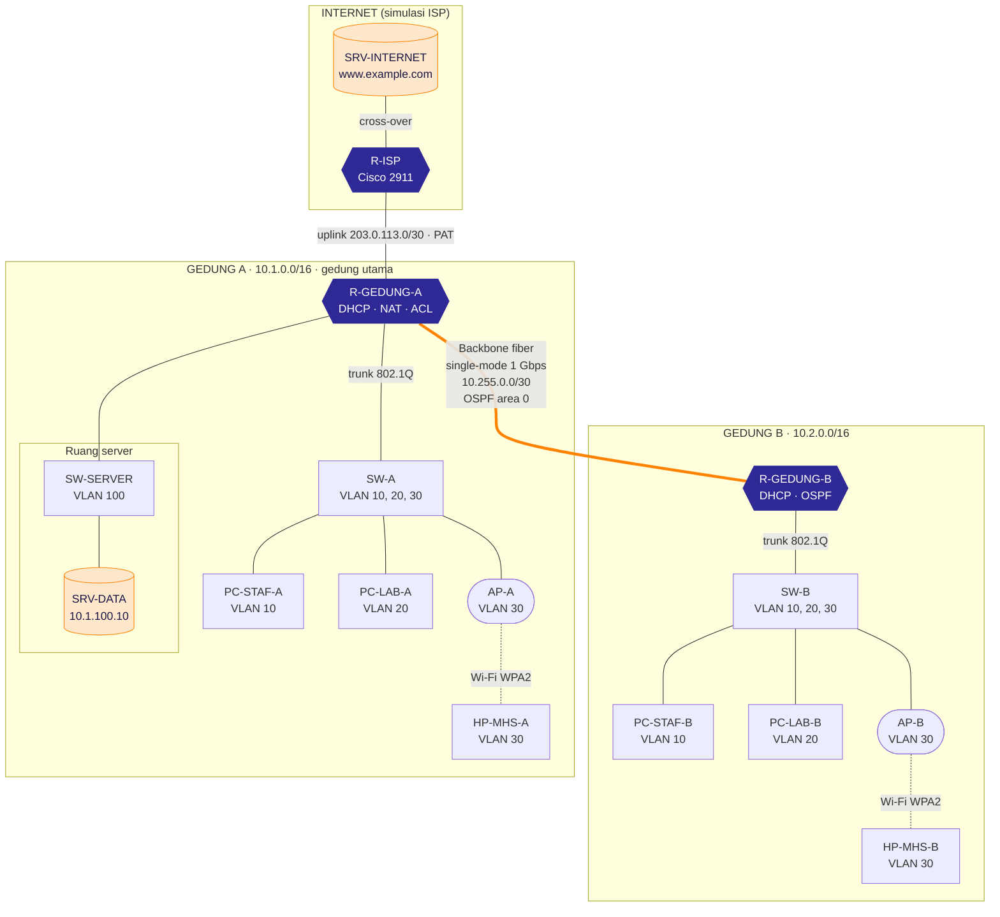

[README.md](https://github.com/user-attachments/files/34509999/README.md)
# Rancang Bangun Jaringan Antar-Gedung UBBG dengan Akses Server Private Menggunakan Cisco Packet Tracer


Proposal Kelompok 3 untuk mata kuliah **Pemodelan Komunikasi Data dan Jaringan (MKKL1031)**.
Dosen pengampu: **Ahmad Mujahid Abdurrahman, S.Kom, M.T**.
Program Studi Ilmu Komputer, Fakultas Sains Teknologi dan Ilmu Kesehatan, Universitas Bina Bangsa Getsempena (UBBG), Banda Aceh, 2026.

Rancangan ini menghubungkan dua gedung kuliah UBBG melalui backbone fiber optik single-mode. Server data ditempatkan di Gedung A dan hanya dapat diakses secara private dari kedua gedung, sedangkan host di internet tidak dapat menjangkaunya. Seluruh rancangan disimulasikan dan diuji di Cisco Packet Tracer sebelum diterapkan pada perangkat nyata.

**Sekilas**

- 2 gedung kuliah, 16 perangkat, 13 kabel, dan 2 koneksi Wi-Fi
- Backbone fiber single-mode 1 Gbps antar-gedung; hanya Gedung A yang terhubung ke ISP
- Server data di VLAN 100 Gedung A, tertutup dari internet
- VLAN IEEE 802.1Q, router-on-a-stick, OSPF area 0 dengan MD5, DHCP, NAT/PAT, ACL extended, dan SSH v2
- 8 skenario pengujian pada mode Realtime dan Simulation

## Daftar Isi

- [Latar Belakang](#latar-belakang)
- [Rumusan Masalah dan Tujuan](#rumusan-masalah-dan-tujuan)
- [Batasan Masalah](#batasan-masalah)
- [Topologi Jaringan](#topologi-jaringan)
- [Alur Komunikasi Data](#alur-komunikasi-data)
- [Rancangan VLAN](#rancangan-vlan)
- [Pengalamatan IP](#pengalamatan-ip)
- [Keamanan dan Akses Private Server](#keamanan-dan-akses-private-server)
- [Alat dan Bahan](#alat-dan-bahan)
- [Pembagian Tugas](#pembagian-tugas)
- [Rencana Pengujian](#rencana-pengujian)
- [Jadwal Kegiatan](#jadwal-kegiatan)
- [Menjalankan Simulasi](#menjalankan-simulasi)
- [Struktur Repositori](#struktur-repositori)
- [Pengembangan Lanjutan](#pengembangan-lanjutan)
- [Daftar Pustaka](#daftar-pustaka)

## Latar Belakang

UBBG di Banda Aceh terus berkembang, baik dari sisi jumlah gedung maupun jumlah mahasiswa. Pada tahun akademik 2023/2024 tercatat 1.724 mahasiswa baru, dan pihak yayasan merencanakan pembukaan Gedung Kampus B dan Gedung Kampus C (Humas UBBG, 2023). Bertambahnya gedung kuliah menuntut jaringan yang menghubungkan setiap gedung secara terencana, karena kegiatan akademik dan administrasi di semua gedung bergantung pada data yang sama.

Data penting kampus, seperti data akademik, keuangan, dan kepegawaian, sebaiknya disimpan terpusat pada satu server agar mudah dikelola dan diamankan. Server tersebut harus dapat diakses dari seluruh gedung, tetapi tidak boleh terbuka ke internet. Kebutuhan ini dipenuhi dengan alamat IP private yang tidak dirutekan di internet (Rekhter dkk., 1996), VLAN untuk memisahkan kelompok pengguna, backbone fiber optik antar-gedung, dan Access Control List (ACL) untuk membatasi akses ke server.

Sebelum perangkat dibeli dan dipasang, rancangan diuji lebih dulu melalui simulasi. Cisco Packet Tracer adalah simulator dari Cisco Networking Academy untuk merancang, mengonfigurasi, dan memecahkan masalah jaringan (Cisco Networking Academy, t.t.-g), dan telah banyak digunakan dalam penelitian perancangan jaringan berbasis VLAN (Sari dkk., 2026; Harjanto & Purnama, 2024; Wijoyo & Asri, 2024; Susanto, 2020).

## Rumusan Masalah dan Tujuan

| No | Rumusan masalah | Tujuan |
|:--:|---|---|
| 1 | Bagaimana merancang topologi jaringan yang menghubungkan dua gedung kuliah UBBG? | Merancang topologi jaringan dua gedung UBBG yang terhubung melalui backbone fiber optik dengan segmentasi VLAN. |
| 2 | Bagaimana memastikan server data di salah satu gedung dapat diakses dari kedua gedung secara private? | Menempatkan server data di Gedung A yang hanya dapat diakses melalui alamat dan jalur private internal kampus. |
| 3 | Perangkat, modul, dan media transmisi apa saja di Cisco Packet Tracer yang dibutuhkan untuk membangun rancangan tersebut? | Merinci perangkat, modul, dan kabel Cisco Packet Tracer yang digunakan beserta fungsinya. |
| 4 | Bagaimana menguji bahwa rancangan berfungsi dengan benar dan server tidak dapat diakses dari internet? | Menguji konektivitas, layanan server, dan keamanan akses melalui simulasi di Cisco Packet Tracer. |

## Batasan Masalah

- Rancangan mengikuti skenario mata kuliah: dua gedung kuliah, satu server data yang ditempatkan di Gedung A, dan kedua gedung mengakses server tersebut secara private.
- Rancangan hanya disimulasikan pada Cisco Packet Tracer 8.2.2 atau versi yang lebih baru, tidak diimplementasikan pada perangkat fisik.
- Nama Gedung A dan Gedung B merupakan penamaan simulasi; denah, jarak antar-gedung, dan jumlah pengguna sebenarnya belum disurvei.
- Topologi dibuat sederhana: setiap gedung memakai satu switch untuk semua VLAN pengguna dan setiap VLAN pengguna diwakili satu perangkat client, sedangkan port switch disiapkan untuk penambahan client.
- Pengalamatan menggunakan IPv4. Internet disimulasikan dengan satu router ISP dan satu server yang memakai blok alamat dokumentasi RFC 5737.

## Topologi Jaringan

Setiap gedung memakai model *collapsed core*, yaitu lapisan core dan distribution digabung pada satu router. Model ini cocok untuk kampus kecil; untuk kampus dengan banyak gedung atau pertumbuhan besar, Cisco menyarankan model hierarki tiga lapis (Cisco Systems, t.t.-b). Setiap gedung memakai satu switch untuk semua VLAN pengguna, ditambah satu switch khusus server di Gedung A, sehingga seluruh rancangan terdiri atas 16 perangkat. Kedua router gedung dihubungkan backbone fiber optik single-mode, dan hanya Gedung A yang terhubung ke ISP.



Garis oranye tebal adalah backbone fiber single-mode dan garis putus-putus adalah koneksi Wi-Fi WPA2-PSK. Garis lainnya adalah kabel copper: cross-over untuk R-ISP ke R-GEDUNG-A dan ke SRV-INTERNET, straight-through untuk sisanya.

<details>
<summary><b>Koneksi port dan jenis kabel</b> (13 kabel)</summary>

| Perangkat 1 | Port | Perangkat 2 | Port | Kabel | Fungsi |
|---|---|---|---|---|---|
| R-ISP | Gi0/0 | R-GEDUNG-A | Gi0/2 | Cross-over | Uplink ISP |
| R-ISP | Gi0/1 | SRV-INTERNET | Fa0 | Cross-over | LAN internet |
| R-GEDUNG-A | Gi0/0/0 | R-GEDUNG-B | Gi0/0/0 | Fiber single-mode | Backbone |
| R-GEDUNG-A | Gi0/0 | SW-A | Gi0/1 | Straight-through | Trunk 802.1Q |
| R-GEDUNG-A | Gi0/1 | SW-SERVER | Gi0/1 | Straight-through | Uplink server |
| SW-SERVER | Fa0/1 | SRV-DATA | Fa0 | Straight-through | VLAN 100 |
| SW-A | Fa0/1 | PC-STAF-A | Fa0 | Straight-through | VLAN 10 |
| SW-A | Fa0/9 | PC-LAB-A | Fa0 | Straight-through | VLAN 20 |
| SW-A | Fa0/17 | AP-A | Port 0 | Straight-through | VLAN 30 |
| R-GEDUNG-B | Gi0/0 | SW-B | Gi0/1 | Straight-through | Trunk 802.1Q |
| SW-B | Fa0/1 | PC-STAF-B | Fa0 | Straight-through | VLAN 10 |
| SW-B | Fa0/9 | PC-LAB-B | Fa0 | Straight-through | VLAN 20 |
| SW-B | Fa0/17 | AP-B | Port 0 | Straight-through | VLAN 30 |

AP-A dan AP-B terhubung secara nirkabel ke HP-MHS-A dan HP-MHS-B (WPA2-PSK). Pemilihan kabel mengikuti panduan koneksi Packet Tracer (Cisco Networking Academy, t.t.-b).

</details>

## Alur Komunikasi Data

1. **Pengalamatan otomatis.** PC dan smartphone meminta alamat IP melalui DHCP ke router gedung masing-masing. Router memberikan alamat sesuai VLAN, gateway, dan DNS 10.1.100.10.
2. **Segmentasi.** Switch menempatkan setiap port ke VLAN sesuai rancangan. Frame yang melewati link trunk diberi tag IEEE 802.1Q agar VLAN asalnya tetap dikenali (IEEE, 2022).
3. **Routing antar-VLAN.** Router menerima frame pada subinterface (*router-on-a-stick*) dan meneruskan paket antar-VLAN di dalam gedung yang sama.
4. **Routing antar-gedung.** OSPF area 0 bertukar rute melalui backbone fiber 10.255.0.0/30 (Moy, 1998), sehingga R-GEDUNG-B mengetahui jalur ke server farm 10.1.100.0/24 dan rute default ke internet.
5. **Akses server.** Paket dari Gedung B mengalir melalui R-GEDUNG-B → backbone fiber → R-GEDUNG-A → SW-SERVER → SRV-DATA. ACL SERVER-FARM-PRIVATE hanya meneruskan paket yang bersumber dari 10.0.0.0/8.
6. **Layanan.** Client membuka portal `http://data.ubbg.internal` yang dijawab DNS pada SRV-DATA, lalu mengakses berkas melalui FTP. Akhiran `.internal` dicadangkan ICANN untuk jaringan private (Domain Incite, 2024).
7. **Akses internet.** Paket dari VLAN pengguna ke internet diterjemahkan dengan PAT ke alamat 203.0.113.2 di R-GEDUNG-A (Srisuresh & Egevang, 2001). Server farm dan VLAN manajemen tidak ikut diterjemahkan.
8. **Perlindungan dari luar.** Paket dari internet yang menuju 10.0.0.0/8 ditolak ACL INTERNET-IN dan tidak memiliki pemetaan NAT statis, sehingga server tidak dapat dijangkau dari internet.

## Rancangan VLAN

| VLAN | Nama | Subnet Gedung A | Subnet Gedung B | Port anggota |
|:--:|---|---|---|---|
| 10 | STAF-DOSEN | 10.1.10.0/24 | 10.2.10.0/24 | SW-A/B Fa0/1–8 |
| 20 | LAB-KOMPUTER | 10.1.20.0/24 | 10.2.20.0/24 | SW-A/B Fa0/9–16 |
| 30 | WIFI-MAHASISWA | 10.1.30.0/24 | 10.2.30.0/24 | SW-A/B Fa0/17–20 |
| 99 | MANAJEMEN | 10.1.99.0/24 | 10.2.99.0/24 | Interface Vlan99 di SW-A dan SW-B |
| 100 | SERVER-FARM | 10.1.100.0/24 | – | SW-SERVER Fa0/1–8 |
| 999 | NATIVE-TIDAK-DIPAKAI | – | – | Native VLAN trunk dan port kosong (Fa0/21–24) |

VLAN 999 tidak dipakai host; port switch yang tidak digunakan dimasukkan ke VLAN ini dan dimatikan (*shutdown*).

## Pengalamatan IP

Pengalamatan memakai pola `10.<gedung>.<VLAN>.0/24`, dengan angka 1 untuk Gedung A dan 2 untuk Gedung B, sehingga lokasi dan VLAN suatu alamat mudah dikenali. Contohnya, `10.2.20.0/24` adalah VLAN 20 (Lab Komputer) di Gedung B. Hanya link ke ISP dan internet simulasi yang memakai blok alamat dokumentasi RFC 5737 (Arkko dkk., 2010).

### Interface router

| Perangkat | Interface | Alamat IP | Keterangan |
|---|---|---|---|
| R-GEDUNG-A | G0/0.10 | 10.1.10.1/24 | Gateway VLAN 10 |
| R-GEDUNG-A | G0/0.20 | 10.1.20.1/24 | Gateway VLAN 20 |
| R-GEDUNG-A | G0/0.30 | 10.1.30.1/24 | Gateway VLAN 30 |
| R-GEDUNG-A | G0/0.99 | 10.1.99.1/24 | Gateway VLAN 99 (manajemen) |
| R-GEDUNG-A | G0/1 | 10.1.100.1/24 | Gateway server farm |
| R-GEDUNG-A | G0/2 | 203.0.113.2/30 | Uplink ISP, alamat publik PAT |
| R-GEDUNG-A | Gi0/0/0 | 10.255.0.1/30 | Backbone fiber |
| R-GEDUNG-B | G0/0.10 | 10.2.10.1/24 | Gateway VLAN 10 |
| R-GEDUNG-B | G0/0.20 | 10.2.20.1/24 | Gateway VLAN 20 |
| R-GEDUNG-B | G0/0.30 | 10.2.30.1/24 | Gateway VLAN 30 |
| R-GEDUNG-B | G0/0.99 | 10.2.99.1/24 | Gateway VLAN 99 (manajemen) |
| R-GEDUNG-B | Gi0/0/0 | 10.255.0.2/30 | Backbone fiber |
| R-ISP | G0/0 | 203.0.113.1/30 | Sisi ISP ke UBBG |
| R-ISP | G0/1 | 198.51.100.1/24 | LAN internet simulasi |

### Server, switch, dan client

| Perangkat | Alamat IP | Gateway | Keterangan |
|---|---|---|---|
| SRV-DATA | 10.1.100.10/24 | 10.1.100.1 | Statis; DNS 10.1.100.10 |
| SRV-INTERNET | 198.51.100.10/24 | 198.51.100.1 | Statis; `www.example.com` |
| SW-SERVER (Vlan100) | 10.1.100.2/24 | 10.1.100.1 | Manajemen switch |
| SW-A (Vlan99) | 10.1.99.2/24 | 10.1.99.1 | Manajemen switch |
| SW-B (Vlan99) | 10.2.99.2/24 | 10.2.99.1 | Manajemen switch |
| PC dan smartphone Gedung A | DHCP 10.1.x.11–254 | 10.1.x.1 | x = 10, 20, atau 30 |
| PC dan smartphone Gedung B | DHCP 10.2.x.11–254 | 10.2.x.1 | x = 10, 20, atau 30 |

Alamat .1 sampai .10 pada setiap VLAN pengguna dikecualikan dari DHCP untuk gateway dan perangkat beralamat statis.

## Keamanan dan Akses Private Server

- Server data ditempatkan pada segmen khusus 10.1.100.0/24 (VLAN 100) di ruang server Gedung A, terpisah dari VLAN pengguna.
- Seluruh jaringan internal memakai blok private 10.0.0.0/8 yang rutenya tidak dipertukarkan di internet (Rekhter dkk., 1996).
- ACL extended **SERVER-FARM-PRIVATE** pada R-GEDUNG-A (G0/1, arah keluar) hanya mengizinkan sumber 10.0.0.0/8 menuju server farm. ACL extended memeriksa alamat sumber, tujuan, protokol, dan port, serta diakhiri penolakan implisit (Cisco Systems, t.t.-a).
- ACL **INTERNET-IN** pada G0/2 arah masuk menolak alamat sumber private dari internet dan semua paket yang bertujuan ke 10.0.0.0/8.
- PAT hanya diterapkan untuk enam subnet VLAN pengguna, tanpa NAT statis ke server, sehingga host di internet tidak dapat memulai koneksi ke server.
- Backbone OSPF dilindungi autentikasi MD5. Manajemen perangkat memakai SSH versi 2, akun lokal, dan ACL pada line VTY yang hanya mengizinkan VLAN 10.
- Switch diperkuat dengan native VLAN 999, `switchport nonegotiate`, PortFast dan BPDU guard pada port akses, serta port yang tidak terpakai dimatikan.

## Alat dan Bahan

### Perangkat di Cisco Packet Tracer

| Perangkat | Jumlah | Nama di topologi | Fungsi dan spesifikasi |
|---|:--:|---|---|
| Router Cisco 2911<br>*Network Devices › Routers* | 3 | R-GEDUNG-A, R-GEDUNG-B, R-ISP | Gateway antar-VLAN, DHCP, OSPF, NAT, dan ACL. Memiliki 3 port 10/100/1000 onboard dan 4 slot EHWIC. R-ISP menyimulasikan penyedia internet. |
| Switch Cisco Catalyst 2960-24TT<br>*Network Devices › Switches* | 3 | SW-A, SW-SERVER, SW-B | VLAN, trunk 802.1Q, dan port akses pengguna. Memiliki 24 port 10/100 dan 2 uplink 10/100/1000, tanpa slot modul. |
| Server-PT<br>*End Devices* | 2 | SRV-DATA, SRV-INTERNET | SRV-DATA menjalankan HTTP, DNS, dan FTP untuk data kampus; SRV-INTERNET menjadi situs internet simulasi. Port FastEthernet0. |
| PC-PT<br>*End Devices* | 4 | PC-STAF-A, PC-LAB-A, PC-STAF-B, PC-LAB-B | Client kabel untuk staf, dosen, dan laboratorium; alamat IP dari DHCP. |
| AccessPoint-PT<br>*Network Devices › Wireless Devices* | 2 | AP-A, AP-B | Hotspot Wi-Fi mahasiswa pada VLAN 30 dengan antena built-in; SSID UBBG-MHS-A dan UBBG-MHS-B, keamanan WPA2-PSK (AES). |
| Smartphone-PT<br>*End Devices* | 2 | HP-MHS-A, HP-MHS-B | Client nirkabel mahasiswa dengan antarmuka Wi-Fi built-in; alamat IP dari DHCP. |
| **Jumlah perangkat** | **16** | | |

### Modul, transceiver, dan media transmisi

| Item | Jumlah | Dipasang/dipakai pada | Fungsi dan spesifikasi |
|---|:--:|---|---|
| HWIC-1GE-SFP | 2 | Slot EHWIC 0 pada R-GEDUNG-A dan R-GEDUNG-B | Kartu HWIC single-wide dengan satu slot SFP; menambah port Gigabit Gi0/0/0 |
| GLC-LH-SMD | 2 | Slot SFP pada HWIC-1GE-SFP | Transceiver 1000BASE-LX/LH, 1310 nm, jangkauan hingga 10 km pada fiber single-mode, konektor LC dupleks |
| Kabel fiber single-mode | 1 | R-GEDUNG-A Gi0/0/0 ke R-GEDUNG-B Gi0/0/0 | Backbone antar-gedung 1 Gbps; wajib single-mode karena modul GLC-LH-SMD |
| Kabel copper straight-through | 10 | Router ke switch; switch ke PC, server, dan access point | Menghubungkan perangkat yang berbeda lapisan OSI |
| Kabel copper cross-over | 2 | R-GEDUNG-A ke R-ISP, dan R-ISP ke SRV-INTERNET | Menghubungkan perangkat yang selapis |
| Koneksi nirkabel | 2 | AP-A ke HP-MHS-A dan AP-B ke HP-MHS-B | Asosiasi Wi-Fi dengan SSID terpisah per gedung |

### Perangkat lunak dan bahan pendukung

| Komponen | Fungsi |
|---|---|
| Cisco Packet Tracer 8.2.2 atau 9.0 | Simulator untuk membangun topologi, mengonfigurasi perangkat, dan menguji jaringan; versi 9.0.0 dirilis Oktober 2025 (Packet Tracer Network, 2025) |
| Mode Realtime dan Simulation | Mode Realtime untuk pengujian langsung (ping, browser, SSH); mode Simulation untuk mengamati paket DHCP, OSPF, dan ICMP langkah demi langkah |
| Akun Cisco Networking Academy | Mengunduh Cisco Packet Tracer resmi secara gratis |
| Laptop/PC | Menjalankan Cisco Packet Tracer dan menyusun laporan |
| Ekstensi PTBuilder (opsional) | Membangun topologi secara otomatis dengan skrip JavaScript (kimmknight, t.t.) |
| Microsoft Word | Penyusunan proposal dan laporan |

## Pembagian Tugas

| Nama | NIM | Tugas |
|---|---|---|
| Agym Abdullah Gymnastiar | 23210130 | Konfigurasi layanan server (HTTP, DNS, FTP), access point, dan client |
| Akhsanul Taqwim | 23210006 | Konfigurasi switch: VLAN, trunk, dan keamanan port |
| Farhan Daffa Zahrani M | 23210134 | Perancangan topologi dan pengalamatan IP, backbone fiber, serta konfigurasi router (OSPF, DHCP, NAT, ACL) |
| Muhammad Dwi Andika | 23210137 | Pengujian dan analisis hasil |
| Vani Andrian AS | 23210144 | Dokumentasi dan penyusunan laporan |

## Rencana Pengujian

| No | Pengujian | Cara | Target |
|:--:|---|---|---|
| 1 | Backbone dan OSPF | `show ip ospf neighbor` dan `show ip route` pada kedua router | Tetangga OSPF berstatus FULL; rute antar-gedung dan rute default tersedia |
| 2 | VLAN dan trunk | `show vlan brief` dan `show interfaces trunk` pada setiap switch | Semua port sesuai rancangan VLAN; trunk memakai native VLAN 999 |
| 3 | DHCP | `ipconfig` pada 4 PC dan 2 smartphone | 100% client mendapat IP, gateway, dan DNS yang benar |
| 4 | Akses server private | Ping dan tracert dari PC Gedung B ke 10.1.100.10 | Ping berhasil 100%; jalur 10.2.20.1 → 10.255.0.1 → 10.1.100.10 tanpa alamat publik |
| 5 | Layanan server | Membuka `http://data.ubbg.internal` dan login FTP ke 10.1.100.10 dari kedua gedung | Portal tampil dan login FTP berhasil dari semua VLAN pengguna |
| 6 | Akses internet | Membuka `www.example.com`, lalu `show ip nat translations` pada R-GEDUNG-A | Halaman tampil; translasi memakai alamat 203.0.113.2 |
| 7 | Server tertutup dari internet | Ping 10.1.100.10 dari SRV-INTERNET, termasuk saat R-ISP diberi rute sementara ke 10.0.0.0/8 | Ping gagal 100%; penghitung aturan deny pada ACL INTERNET-IN bertambah |
| 8 | Manajemen SSH | `ssh -l admin` ke switch dari PC VLAN 10 dan PC VLAN 20 | Berhasil dari VLAN 10 dan ditolak dari VLAN 20 |

Pengujian dijalankan pada mode Realtime dan diamati pada mode Simulation Packet Tracer; setiap hasil didokumentasikan dengan tangkapan layar.

## Jadwal Kegiatan

| Kegiatan | Minggu 1 | Minggu 2 | Minggu 3 | Minggu 4 |
|---|:--:|:--:|:--:|:--:|
| Studi literatur dan analisis kebutuhan | ✓ | | | |
| Perancangan topologi, VLAN, dan pengalamatan IP | ✓ | ✓ | | |
| Pembangunan topologi dan konfigurasi di Packet Tracer | | ✓ | ✓ | |
| Pengujian dan pengambilan data | | | ✓ | ✓ |
| Analisis dan penyusunan laporan | | | | ✓ |

## Menjalankan Simulasi

Topologi dapat dibangun otomatis dengan ekstensi [PTBuilder](https://github.com/kimmknight/PTBuilder) memakai skrip [`UBBG-Builder.js`](UBBG-Builder.js).

1. **Pasang PTBuilder.** Unduh `Builder.pts` dari repositori PTBuilder, lalu di Packet Tracer pilih **Extensions › Scripting › Configure PT Script Modules › Add...**. Langkah ini cukup sekali per komputer.
2. **Bangun topologi.** Buka **File › New**, lalu **Extensions › Builder Code Editor**. Tempel seluruh isi `UBBG-Builder.js` dan klik **Run**. Skrip memasang 16 perangkat, modul HWIC-1GE-SFP dan GLC-LH-SMD, 13 kabel, konfigurasi IOS tiga router dan tiga switch, IP statis kedua server, serta DHCP pada empat PC.
3. **Tunggu link aktif.** Klik **Fast Forward Time** beberapa kali sampai semua link berwarna hijau. Jika PC belum mendapat IP, jalankan `ipconfig /renew` di Command Prompt PC tersebut.
4. **Konfigurasi lewat GUI.** Bagian ini tidak dapat diatur dengan skrip:
   - SRV-DATA: DNS (`data.ubbg.internal` → 10.1.100.10 dan `www.example.com` → 198.51.100.10), HTTP, dan FTP.
   - SRV-INTERNET: HTTP untuk halaman `www.example.com`.
   - AP-A dan AP-B (**Config › Port 1**) serta HP-MHS-A dan HP-MHS-B (**Config › Wireless0**): SSID `UBBG-MHS-A` atau `UBBG-MHS-B`, WPA2-PSK, enkripsi AES.
5. **Simpan dan uji.** Simpan sebagai `UBBG-Kelompok3.pkt`, lalu jalankan delapan pengujian di atas. Langkah lengkapnya ada di `panduan.html` (buka di browser).

Tanpa PTBuilder, susun perangkat dan kabel sesuai tabel koneksi port, lalu tempel isi file di folder [`konfigurasi-cli`](konfigurasi-cli) ke tab CLI perangkat yang namanya sama.

> [!NOTE]
> Pada `konfigurasi-cli/R-GEDUNG-A.txt`, ACL INTERNET-IN diberi tambahan izin untuk paket balasan (TCP *established* serta ICMP echo-reply, unreachable, dan time-exceeded) sebelum aturan tolak 10.0.0.0/8, agar PAT tetap berjalan di Packet Tracer. Koneksi baru dari internet ke jaringan internal tetap ditolak.

<details>
<summary><b>Kredensial simulasi</b></summary>

| Keperluan | Nilai |
|---|---|
| Login console dan SSH router/switch | `admin` / `UbbgAdmin26` |
| Enable secret | `UbbgEnable26` |
| Kunci OSPF MD5 (key 1) | `UbbgOspf26` |
| Wi-Fi Gedung A | SSID `UBBG-MHS-A`, pass phrase `MhsUbbgA26` |
| Wi-Fi Gedung B | SSID `UBBG-MHS-B`, pass phrase `MhsUbbgB26` |
| FTP SRV-DATA | `staf` / `UbbgFtp26` |

Kata sandi ini hanya untuk simulasi.

</details>

## Struktur Repositori

```text
.
├── README.md
├── UBBG-Builder.js              # skrip PTBuilder pembangun topologi
├── UBBG-Kelompok3.pkt           # file simulasi Packet Tracer
├── panduan.html                 # panduan konfigurasi GUI dan 8 pengujian
├── konfigurasi-cli/             # konfigurasi IOS setiap perangkat
│   ├── R-GEDUNG-A.txt
│   ├── R-GEDUNG-B.txt
│   ├── R-ISP.txt
│   ├── SW-A.txt
│   ├── SW-B.txt
│   └── SW-SERVER.txt
├── konfigurasi-gui/             # isi index.html untuk layanan HTTP
│   ├── SRV-DATA-index.html
│   └── SRV-INTERNET-index.html
└── dokumen/
    ├── Proposal_PKDJ_Jaringan_Antar_Gedung_UBBG.pdf
    └── Presentasi_Proposal_PKDJ_Jaringan_Antar_Gedung_UBBG.pptx
```

## Pengembangan Lanjutan

- Jalur fiber cadangan antar-gedung
- Redundansi gateway, misalnya HSRP
- Firewall khusus di sisi internet
- Model hierarki tiga lapis bila jumlah gedung bertambah

## Daftar Pustaka

- Arkko, J., Cotton, M., & Vegoda, L. (2010). *IPv4 address blocks reserved for documentation* (RFC 5737). Internet Engineering Task Force. <https://datatracker.ietf.org/doc/rfc5737/>
- Cisco Networking Academy. (t.t.-a). *Configuring servers*. Packet Tracer Tutorials. <https://tutorials.ptnetacad.net/help/default/config_servers.htm>
- Cisco Networking Academy. (t.t.-b). *Connections / links*. Packet Tracer Tutorials. <https://tutorials.ptnetacad.net/help/default/connectionsLinks.htm>
- Cisco Networking Academy. (t.t.-c). *Devices and modules: End devices*. Packet Tracer Tutorials. <https://tutorials.ptnetacad.net/help/default/devicesAndModules_endDevices.htm>
- Cisco Networking Academy. (t.t.-d). *Devices and modules: Other devices*. Packet Tracer Tutorials. <https://tutorials.ptnetacad.net/help/default/devicesAndModules_others.htm>
- Cisco Networking Academy. (t.t.-e). *Devices and modules: Routers*. Packet Tracer Tutorials. <https://tutorials.ptnetacad.net/help/default/devicesAndModules_routers.htm>
- Cisco Networking Academy. (t.t.-f). *Devices and modules: Switches*. Packet Tracer Tutorials. <https://tutorials.ptnetacad.net/help/default/devicesAndModules_switches.htm>
- Cisco Networking Academy. (t.t.-g). *Introduction*. Packet Tracer Tutorials. <https://tutorials.ptnetacad.net/help/default/intro.htm>
- Cisco Systems. (2005). *Cisco Catalyst 2960 Series switches* (Product Bulletin No. 3041). <https://www3-realm.cisco.com/en/US/prod/collateral/switches/ps5718/ps6406/prod_bulletin0900aecd80322c22.html>
- Cisco Systems. (t.t.-a). *Configure commonly used IP ACLs*. <https://www.cisco.com/c/en/us/support/docs/ip/access-lists/26448-ACLsamples.html>
- Cisco Systems. (t.t.-b). Small Enterprise Design Profile (SEDP)—Network foundation design. Dalam *Small Enterprise Design Profile reference guide*. <https://www3-realm.cisco.com/en/US/docs/solutions/Enterprise/Small_Enterprise_Design_Profile/chap2.html>
- Domain Incite. (2024, 1 Agustus). *It's official: .internal is blocked forever*. <https://domainincite.com/30091-its-official-internal-is-blocked-forever>
- Harjanto, H., & Purnama, G. (2024). Perancangan dan simulasi jaringan komputer dengan metode pengembangan Network Development Life Cycle (NDLC) pada kantor cabang PT. V2 Indonesia. *JATI (Jurnal Mahasiswa Teknik Informatika), 8*(4), 8032–8039. <https://ejournal.itn.ac.id/jati/article/view/10622>
- Humas UBBG. (2023). *E-Kliping UBBG, 12 Oktober 2023* [Kliping berita, memuat laporan Serambinews.com 12 September 2023]. Repositori Universitas Bina Bangsa Getsempena. <https://repository.bbg.ac.id/bitstream/1693/1/News_Clippings_12102023_464.pdf>
- IEEE. (2022). *IEEE standard for local and metropolitan area networks—Bridges and bridged networks* (IEEE Std 802.1Q-2022). <https://standards.ieee.org/ieee/802.1q/10323/>
- kimmknight. (t.t.). *PTBuilder: Packet Tracer Builder* [Repositori GitHub]. <https://github.com/kimmknight/PTBuilder>
- Moy, J. (1998). *OSPF version 2* (RFC 2328). Internet Engineering Task Force. <https://www.rfc-editor.org/info/rfc2328>
- Optinoc. (t.t.). *Cisco GLC-LH-SMD: Specifications*. <https://optinoc.com/blog/cisco-glc-lh-smd/>
- Packet Tracer Network. (2025). *Download Cisco Packet Tracer 9.0.0*. <https://www.packettracernetwork.com/download/>
- Rekhter, Y., Moskowitz, B., Karrenberg, D., de Groot, G. J., & Lear, E. (1996). *Address allocation for private internets* (RFC 1918). Internet Engineering Task Force. <https://www.rfc-editor.org/rfc/rfc1918>
- Sari, M., Dari, R. U., Dani, S. R., Irma, A., & Manullang, K. R. (2026). Analisis implementasi virtual local area network (VLAN) dalam meningkatkan efisiensi dan keamanan pengolahan data pada sistem komputer: Kajian literatur dan simulasi Cisco Packet Tracer. *NUSANTARA: Jurnal Ilmu Pengetahuan Sosial, 13*(6), 1467–1474. <https://jurnal.um-tapsel.ac.id/index.php/nusantara/article/view/25047>
- Srisuresh, P., & Egevang, K. (2001). *Traditional IP network address translator (Traditional NAT)* (RFC 3022). Internet Engineering Task Force. <https://datatracker.ietf.org/doc/rfc3022/>
- Susanto, R. (2020). Rancang bangun jaringan VLAN dengan menggunakan simulasi Cisco Packet Tracer. *InfoTekJar: Jurnal Nasional Informatika dan Teknologi Jaringan, 4*(2). <https://jurnal.uisu.ac.id/index.php/infotekjar/article/download/2297/pdf>
- Wijoyo, R. P., & Asri, S. D. (2024). Perancangan infrastruktur jaringan di kantor dengan simulasi menggunakan Packet Tracer: Studi kasus di V2 Service Center. *JATI (Jurnal Mahasiswa Teknik Informatika), 8*(4), 7864–7871. <https://ejournal.itn.ac.id/jati/article/view/10489>

---

Ringkasan dari proposal Kelompok 3 (Rev. 3 November 2026).
